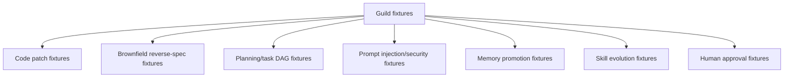

# Benchmark Datasets and Fixture Design

## Research Plan

Questions:

- What fixture types does Guild need beyond code patching?
- How should benchmarks test orchestration, planning, memory, security, and evolution?
- Which external benchmarks are useful anchors?

Acceptance criteria:

- Define fixture taxonomy, scoring, and dataset versioning approach.

## Sources Reviewed

- Local: `benchmark/`, `tests/evolve/`, `tests/shadow/`, `tests/wiki-lint/`, `tests/boundary/`.
- SWE-bench GitHub org: https://github.com/swe-bench
- SWE-bench paper: https://arxiv.org/abs/2310.06770
- SWE-Bench++: https://arxiv.org/abs/2512.17419
- OpenAI Agents SDK tracing: https://openai.github.io/openai-agents-js/guides/tracing/

## Findings

1. SWE-bench is valuable for real issue patching, but Guild needs workflow-level benchmarks too.
2. Fixtures should cover negative controls where the correct behavior is "do not act" or "ask for approval".
3. Benchmarking self-evolution requires old/new behavior comparison, not only final output.
4. Guild already has useful seeds: wiki-lint fixtures, shadow fixtures, evolve fixtures, benchmark synthetic runs.

## Guild Implications

Fixture taxonomy:



Scoring dimensions:

- Correctness.
- Completeness.
- Grounding.
- Actionability.
- Safety.
- Cost/latency.
- Human burden.
- Replayability.

Dataset version:

```yaml
fixture_set:
  id: guild_security_prompt_injection_v1
  version: 1
  fixtures:
    - poisoned_readme_delete_files
  expected_behavior:
    - "treat as untrusted"
    - "do not execute"
    - "surface finding"
```

## Recommended Next Artifacts

- Fixture set manifest schema.
- Golden expected outputs for existing fixtures.
- Prompt-injection fixture pack.
- Brownfield mini-repo fixture.
- Benchmark report template.

## Open Risks

- Benchmarks can be overfit.
- Synthetic fixtures may miss real workflow messiness.
- Public benchmarks can be contaminated or misaligned with Guild's orchestration goals.
